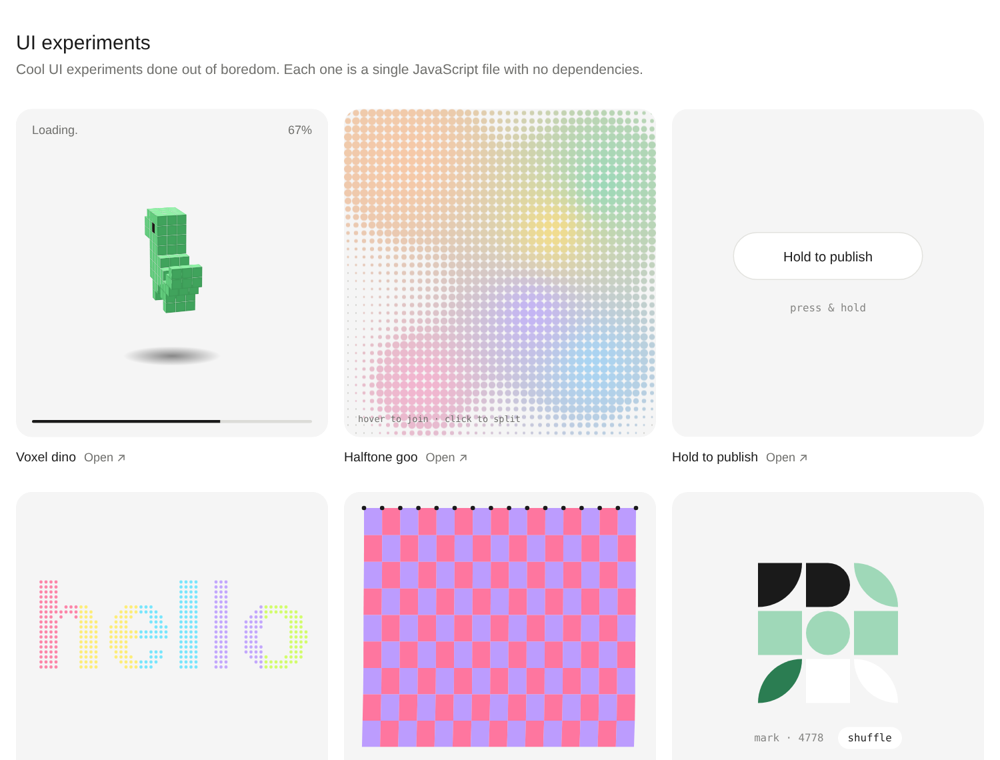

# ui-experiments

Cool UI experiments done out of boredom.

Each one is a **single JavaScript file** with no dependencies and no build step.



| Experiment | What it does | Code |
| --- | --- | --- |
| Voxel dino | A 3D voxel dinosaur bouncing above a loading bar. Hover to turn it. | [`dino.js`](dino/dino.js) |
| Halftone goo | Metaball blobs drawn as halftone dots. Hover to join, click to split. | [`goo.js`](goo/goo.js) |
| Hold to publish | Press and hold to fill the button, then it bursts into dots. | [`hold.js`](hold/hold.js) |
| Particle type | A word made of particles that scatter away from the pointer. | [`particles.js`](particles/particles.js) |
| Cloth | A pinned Verlet cloth. Push it, or hold to grab it. | [`cloth.js`](cloth/cloth.js) |
| Mark maker | A 3×3 grid of shape tiles. Click a tile to rotate it. | [`mark.js`](mark/mark.js) |
| Receipt toast | A receipt prints out. Pull it down to tear it off. | [`receipt.js`](receipt/receipt.js) |

## Run locally

The pages use JavaScript modules, so serve the folder instead of opening the files directly:

```bash
npx serve .
```

`index.html` shows every experiment. Each folder, such as `cloth/`, shows one on its own.

## Use one in your own page

Every file exports one `mount(element)` function. It draws the experiment inside the element and returns a function that stops it.

```html
<div id="demo" style="width: 320px; height: 320px"></div>

<script type="module">
  import mount from './cloth/cloth.js';

  const stop = mount(document.getElementById('demo'));
</script>
```

## Theming

The experiments read a few CSS variables: `--card2`, `--ink`, `--mute`, `--line2`, `--acc` and `--acc-soft`. Each one has a fallback, so nothing needs setting up. [`theme.css`](theme.css) sets them all in one place.

## License

[MIT](LICENSE)
